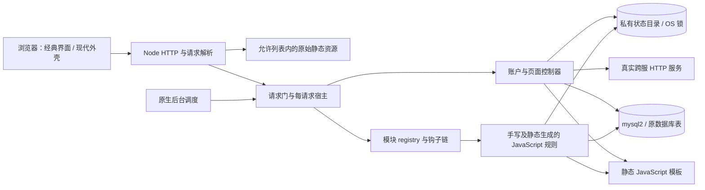

# 原生 Node.js 架构

生产请求在 Node.js 中执行静态 JavaScript 游戏规则、页面控制器和模板，通过 mysql2 访问原 MySQL/MariaDB 表。没有 PHP WebAssembly、PHP 子进程、运行期 PHP 解析器或 PHP daemon。旧 `runtime/` 代码保留作开发回归，不属于原生请求链。

## 源码、生成代码与资源

| 位置 | 职责 |
| --- | --- |
| `native/server.mjs`、`config.mjs`、`setup.mjs`、`compile.mjs`、`doctor.mjs` | 原生进程入口、安装、配置与校验。 |
| `native/http/` | 请求解析、静态资源边界、应用路由、每请求宿主、原页面入口与维护门。 |
| `native/modules/registry.mjs`、`native/catalog.mjs`、`native/bootstrap.mjs` | 模块声明、依赖排序、覆盖链及活动清单组装。 |
| `native/gameplay/`、`native/system/`、`native/accounts/` | 手工移植的游戏机制、系统状态、账户、管理和维护服务。 |
| `native/storage/` | mysql2、真实 OS 锁、私有文件及资源访问。 |
| `native/generated/`、`native/templates/generated/` | 开发期生成、生产直接导入的 JavaScript 规则、页面和模板。 |
| `native/protocol/`、`native/random.mjs` | 原编码协议、录像容器、随机及数据边界功能。 |
| `scripts/native-compiler/` | 开发期解析原 PHP/模板并生成上述静态文件的工具。 |
| `engine/`、`upstream/manifest.json` | 原源码和资源快照、版本及逐文件来源记录。 |
| `public/modern/` | 保留原表单、控件与录像 DOM 路径的可切换界面外壳。 |

不是所有原生函数都手工重写：一部分由开发期 `php-parser` 工具按原函数控制流生成 JavaScript，再通过原生服务绑定数据库、模板、文件、账户和网络。生产只导入这些已保存的 `.mjs`，不根据 HTTP 输入加载代码，不执行 PHP 或 `eval`。生成代码中的 `r.*` 调用是静态 JavaScript 数据与服务辅助函数，并非可加载任意 PHP 程序的运行器；它们仍是调试时需要理解的一层公共语义库。

这些辅助函数保留有实际调用需求的数组顺序、引用槽、字符串/二进制、数字格式和协议行为。它们不等于实现了整门 PHP，也不能据此宣布未对照的动态代码自动兼容。错误会在原生 JavaScript 模块、辅助函数或显式宿主服务中定位，不再跨 Node 与 PHP 两个执行引擎排查。

默认开发在 `native/` 修改。手工模块可直接维护 JavaScript；生成模块的头部注明原路径和生成器。可以经过回归后将规则改为手工模块并更新静态注册，或维护开发期转换器，但不能只改生成文件后又无审查地全量生成，覆盖刚完成的修改。`build-modules.mjs`、`build-pages.mjs`、`build-templates.mjs` 等会重写输出及清单；它们不在生产 `npm run compile` 中运行。原快照变更须说明来源差异，不能改来源清单掩盖修改。

## 模块与请求状态

模块依赖采用原加载规则的 FIFO 排序，保留声明的必需依赖、可选依赖、冲突和同名函数覆盖次序。`ctx.next()` 调用下一层原生钩子；模块之间通过明确的 `ctx.call()`、导入字段和 reference 槽连接。模块文件存在、函数全部导出与组合玩法已经验证是不同的结论。

每个动态请求创建自己的 module session、可变状态、PRNG、数据库连接和锁持有者；配置与状态副本隔离，连接和服务放在 `services`，不放入需要复制的游戏状态。PHP 原本的共享引用在必要边界以 getter/setter 或 reference 槽保留，例如玩家平铺字段与 `sdata` 的双向更新。按数字键插入仍须保持次序的池和排行使用明确的有序表示。

原表结构、表前缀、房间表、文本协议 SQL 值、账号哈希及 Cookie 协议保留。数据库服务提供原查询接口对应的原生方法，但不会用内存 mock 或 SQLite 代替生产数据库。MyISAM 和 MEMORY 表没有因为 Node 化变成事务表，跨数据库/文件操作也不自动获得事务保证。

HTTP 只分派静态注册的页面名称，`.php` URL 保留兼容原链接与前端协议，实际执行的是 JavaScript。原 `render_page()` 在宿主内调用原生页面，不为每次页面渲染启动另一套 PHP 请求池。静态资源另走扩展名与目录允许列表，配置、SQL、源代码和私有备份不作为静态文件公开。

请求解析对原表单、Cookie、重复键与输入过滤有独立 PHP 对照。代理信任只在 HTTP 边界决定；账户服务取得经过信任判断的 `REMOTE_ADDR`，不会再信任任意代理头。公开部署约定见 [DEPLOYMENT.md](DEPLOYMENT.md)。

## 调度、锁与维护

后台调度遍历主局和进行中的房间，调用真实 `sys.routine`。原三点每日维护条件仍按游戏时间判断，文件年龄和远端签名使用墙钟时间。管理页面显示和控制当前 Node 调度器，不伪造旧 PHP 端口进程；旧 `start`/`stop` daemon 行为已由原生进程生命周期替代。

`native-process-owner` OS 锁覆盖整个实例进程。离线安装、校验/应用候选与启动共用该锁；资源级锁保护玩家、账户、文件和维护操作。锁扩展不可用就失败，超时不允许继续当作已获得锁。锁文件保留，进程退出由 OS 释放持有权。单进程实例不等于所有请求串行，也不代表支持多个实例同时写同一服。

`maintenance.request()` 让正常动态请求和调度任务加入同一活动集合；`maintenance.run()` 暂停新请求、排空其他请求后执行需要独占的替换。账户恢复先完整校验，写入独立临时表，再切换表名；不会先清空当前用户表再尝试解析上传文件。

自动维护保留清理旧垃圾邮件、清理临时录像文件、远端录像传输、清理已远端备份的旧录像、三代本地用户备份、清理过期缓存六类业务。已对照原每日节流及文件状态缓存影响。录像远端会回调本机，因此不能把整个远端传输包在独占维护门中；只有本地用户快照排空写入。重叠维护通过 OS 锁拒绝等待，避免持锁请求与维护门互相等待。

原可执行 PHP 录像进度改为私有 JSON；中断后恢复待发送列表会先恢复已有进度。备份先完整生成快照再轮换旧文件，锁超时失败关闭；目录不会作为“文件已删除”虚报。这些运维差异明确保留在实现和测试中，不伪称逐字复刻原文件副作用。

关闭进程时停止新调度和动态请求，等待现有请求、用户库远端锁和数据库连接结束后释放实例锁。真实跨服 HTTP、长轮询和关闭时的取消各有明确服务边界；未完成的远端响应不会被当作成功存档。

## 账户与跨服边界

登录、注册、改密、用户设置、消息奖励、管理员操作和安装使用原生服务。初始安装只接受专用空数据库及空目录；重复启动核对文件与数据库的双重 owner，不自动认领旧 PHP/WASM 数据。

远程用户库客户端按请求持有远端锁租约，宿主在请求结束时释放。接收器在实例内长期存活，维护跨请求的租约和真实 OS 锁。远程活动排行共用显式用户库 peer 授权和时间签名；录像使用独立 peer 文件与反向 HTTP 回调。密钥不会从公开源码样例自动启用。此模型未提供多进程负载均衡的共享租约存储。

模块管理只允许静态注册的原生模块，编辑启停清单、检查依赖与模板构建后才保存可激活候选。激活再次检查当前清单和构建指纹；在线应用经维护门，离线 CLI 必须持实例 OS 锁。修改实现代码仍需重启 Node。两个历史一次性用户升级/补卡工具只显示经鉴权的只读审计说明，不自动重放历史数据变更。

## 验证范围

来源清单、静态构建覆盖、独立函数 PHP 差分、真实数据库持久化、完整 HTTP 链路和浏览器回归分别提供不同证据。原生测试包含真实 OS 锁、双人战斗后存取、账户及管理流程、录像与跨服回调；生产不用测试替身来满足缺失服务。

所有模块被注册不意味着所有技能组合、多人竞争、长局结算和运营场景都经过逐一游玩验收。测试和已知边界以 [NATIVE-MIGRATION.md](NATIVE-MIGRATION.md) 为准。目标 VPS 的 Docker/Compose、Linux 部署、恢复演练和容量测试尚不能从本地结果推断为已通过。
