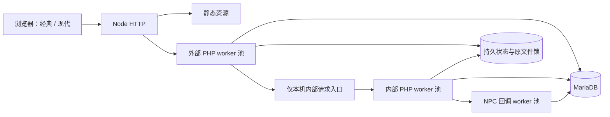

# Node 托管与兼容边界

HTTP 请求进入 Node，静态资源由 Node 直接返回，动态入口交给线程内的 PHP WebAssembly。源码仍保留 64 位 PHP 数值语义和原 mysqli SQL。既没有启动 PHP 子进程，也没有要求独立 PHP 服务。

原页面使用 `render_page()` 经本机 HTTP 调用 `command.php`，部分 NPC 行为还会再回调一次。为守住隔离语义，当前保留该协议，但把监听和执行实例统一纳入 Node：外部、内部、NPC 回调分池，避免父请求占住唯一实例后等待自身。worker_threads 同时避免同步 PHP 或文件锁阻塞 Node 的 HTTP 事件循环。

不能把多个 PHP 实例简单放在同一个 JS 线程并发执行：共享文件锁的同步等待可能阻塞整个事件循环。运行层测试包含双 worker 争用真实文件锁的检查。

## 被替代的 daemon 职责

| 旧职责 | Node 版 |
| --- | --- |
| shell/bat 启动、保活 daemon | Node 启动并管理执行线程 |
| 浏览器请求经 daemon socket 转发 | HTTP 请求交给隔离 PHP worker |
| 房间 socket 等待与唤醒 | Node 长轮询，短 PHP 请求检查原状态 |
| daemon 分支记录录像 | 请求末尾桥接，保存原响应与录像索引格式 |
| 仅 daemon 才归档录像 | 精确兼容补丁允许 Node 版执行原归档 |
| 每日维护唤醒 | Node 定时触发原维护，仍由原逻辑节流 |

ADV1/ADV2/ADV3 保留并开启，SRV 与已停止维护的 COMBINE 关闭。原 daemon 是模块常驻优化；当前 PHP 请求仍有模块装载开销，不能宣称比原 daemon 更快。真正消除该开销或全面改进并发，要进一步迁移引擎状态模型并做基准测试。

## 原版快照与补丁

`engine/` 是未修改的快照，`upstream/manifest.json` 记录逐文件 SHA-256。启动将它同步到 `var/game`，通过 `runtime/patches.mjs` 的精确匹配补丁接入运行层；匹配不唯一会报错，防止上游变动后静默误改。

`runtime/prepend.php` 声明兼容运行环境，`replay-bridge.php` 完成录像记录，`compile-engine.php` 复用原模块验证和编译器，`install.php` 复用完整原 SQL 初始化专用空库。安装器只接受内部调用，原公开网页安装入口不开放。静态服务采用允许列表，PHP 源码、SQL、配置与玩家数据不能通过静态路径下载。

客户端 IP 的信任在 Node HTTP 边界决定：默认使用连接对端；显式启用 `TRUST_PROXY=1` 后才接受受控单层反代覆盖的单个合法 `X-Forwarded-For` 地址。进入 PHP 前移除原引擎会无条件信任的 IP 头，统一通过 `REMOTE_ADDR` 提供结果。部署配置见 [DEPLOYMENT.md](DEPLOYMENT.md)。上游 IPv4 解析限制仍保留。

持久化目录完整包含原运行树。同步只覆盖源文件发生变化或目标缺失的文件；运行时生成的数据不在原清单中，不会被清理。不要将 `var/game` 当第二个长期开发分支。

## 保留的边界

- PHP 的语言、模块钩子、数据库结构和原游戏锁仍在；Node 不会自动解决原设计中的竞争、事务或性能问题。
- 多实例横向扩容尚不支持。单服部署可以使用多个隔离 worker，但应先做目标玩家量的压测。
- 游戏保留原版账号认证和格式，迁移未擅自重置历史密码或改动哈希算法。
- 原跨服排行、远程用户库、远程录像仍需要对应服务与凭据；打包源码不能替代这些外部服务。
- 原版资源的引用和授权保持原样。模块关闭状态也保持原清单，不因为移植而把实验模块全部开启。

测试以实际功能和对应原代码为依据。770 个启用模块不等于770个已逐个游玩验证的模块；应在公测中继续使用玩法回归表记录组合技能、多人竞争和长局结算的覆盖。
